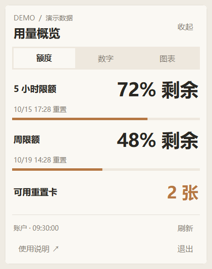

# Codex TokenUse

给已有的 Codex 桌宠加一个轻量用量面板。鼠标悬停桌宠，点击「用量」，在 **额度 / 数字 / 图表**之间切换。

**[下载 Windows 免安装版](https://github.com/Qiu1717/codex-tokenuse/releases/latest)** · [反馈问题](https://github.com/Qiu1717/codex-tokenuse/issues) · [更新记录](CHANGELOG.md)

> 支持 Windows 10/11 x64。需要先安装、登录 Codex，并显示原有桌宠。下载包自带运行环境，不需要安装 Python、Node.js，不需要 API Key。



## 可以看什么

| 页面 | 内容 |
| --- | --- |
| 额度 | 五小时和周额度剩余百分比、重置时间、可用重置卡数量 |
| 数字 | 今日、近七天、累计 token 完整数字，以及未缓存输入、缓存输入、输出明细 |
| 图表 | 七日用量柱状图、累计构成占比；悬停柱状图查看具体数字 |

- 暖白色入口、圆角卡片和橙褐色图表，三页单独查看。
- 记住上次选择的页面，跟随桌宠移动和隐藏。
- 鼠标移开约 1.2 秒收起，不覆盖原桌宠的点击和拖动区域。
- 仅复用现有桌宠，不安装或分发宠物素材，不修改 Codex 程序。

## 使用方法

1. 在 [Releases](https://github.com/Qiu1717/codex-tokenuse/releases/latest) 下载 `codex-tokenuse-v0.1.0-windows-x64.zip`。不要把 GitHub 自动生成的 Source code 当作免安装包。
2. **完整解压 ZIP**，保留旁边的 `_internal` 文件夹。
3. 双击 `CodexTokenUse.exe`。
4. 在 Codex 中显示桌宠，例如使用 `/pet` 或应用中的「显示桌宠」。
5. 鼠标悬停桌宠，点击小胶囊「用量」，选择需要的页面。

从面板右下角点击「退出」关闭本程序，原 Codex 桌宠会继续运行。没有设置开机启动。

当前下载包未进行代码签名，Windows 可能提示未知发布者。可以用发布页提供的 SHA-256 校验文件核对下载内容；不要关闭系统安全功能。

## 数据来源和隐私

**Token 统计：**通过固定版本 [ccusage](https://github.com/ccusage/ccusage) 读取本机 Codex 活动和归档会话记录，统计过程离线运行。缓存输入只计算一次，推理 token 已包含在输出中。近七天是含今日在内的七个自然日，时间按北京时间显示；没有本机记录的日期不会假装成用量为零。

**账户额度：**仅向 `chatgpt.com` 查询当前用户的五小时、周额度和可用重置卡。使用本机既有 Codex 登录，凭据只在内存中读取并通过标准输入传给 Windows 自带的 curl，不写入配置、缓存或日志。程序不会兑换重置卡，也不会上传会话内容。

额度接口是社区项目使用的非公开接口，可能因 Codex 更新或网络变化而失效。读取失败会标明状态并保留旧数据；未知卡数显示「未知」，不会当成 0。页面显示上次更新时间。

- Token 数据仅覆盖当前电脑保留的日志，不代表所有设备的账户总用量。
- 本地 token 数量不能直接换算为订阅额度百分比，也不是官方账单。
- 统计页面按需刷新：本地用量约每 30 秒一次，账户额度约每 60 秒一次；也可以手动刷新。
- 配置、缓存和日志默认保存在 `%LOCALAPPDATA%\codex-tokenuse`；不写入程序目录。
- Codex 目录默认是 `%USERPROFILE%\.codex`，设置了 `CODEX_HOME` 时优先使用该目录。

## 常见问题

**启动后没有出现卡片？** 先确认 Codex 原生桌宠已经显示，再把鼠标放到桌宠上。本程序平时隐藏，首次未检测到显示中的桌宠时会提示操作方法。仍无法退出时，可在任务管理器中结束 `CodexTokenUse.exe`。

**额度读不到，但 token 能看？** 两种数据来源不同。确认 Codex 登录仍有效、系统代理可用，然后点击「刷新」。程序遵循 Windows/环境中的代理设置，不需要粘贴登录 token。

**角色本身变透明或消失？** 这也可能是 Codex 原生桌宠的绘制问题；本程序不会重画角色。可以先退出本程序对照，再从 Codex 隐藏并重新显示桌宠。不要直接删除会话记录或登录文件。

**是否支持其他桌宠软件、macOS 或 Linux？** 目前没有支持。首个版本只针对 Windows x64 的 Codex 原生桌宠；Codex 更新后的窗口实现变化可能需要适配。

## 从源码运行

开发环境需要 Windows x64、Python 3.10+（含 Tk）和 Node.js/npm。Node.js 只用于下载固定版本的 ccusage；打包后的用户不需要它。

```powershell
git clone https://github.com/Qiu1717/codex-tokenuse.git
cd codex-tokenuse
python -m venv .venv
.\.venv\Scripts\python.exe -m pip install -r requirements-build.txt
npm ci --ignore-scripts
.\.venv\Scripts\python.exe app.py
```

## 测试和构建

```powershell
.\.venv\Scripts\python.exe -m pytest -q
.\.venv\Scripts\python.exe scripts\build.py
```

构建脚本运行测试、打包 Python/Tk 和 ccusage、执行无 Node 环境自检，再生成 ZIP 和 SHA-256 校验文件。产物位于 `dist`；源码及发布包不会收集开发者的登录、会话和本地统计缓存。

提交 `v*` 标签会触发 GitHub Actions 的 Windows 构建，产物可从该次 workflow 下载。仓库源码不包含可执行文件，发布下载包放在 Releases。

## 项目结构

```text
app.py                 桌宠窗口跟随、三页界面与后台刷新
core.py                统计、趋势、额度规范化和布局
paths.py               当前用户目录与打包资源识别
quotas.py              账户额度只读查询
tests/                 统计、隐私边界和可移植性测试
scripts/build.py       Windows 发布包构建与校验
docs/                  演示截图和发布检查清单
```

## 致谢与许可

应用源码采用 [MIT License](LICENSE)。统计由 ccusage 提供，界面布局参考 shadcn/ui 的分页思路；本程序不是 OpenAI 官方产品，也未分发 Codex 或任何自定义桌宠素材。

下载包中的 Python、Tcl/Tk、PyInstaller bootloader 和 ccusage 许可见 [第三方说明](THIRD_PARTY_NOTICES.md)及包内 `licenses` 文件夹。
